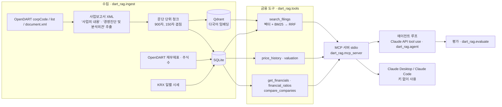

# DART 공시 RAG · MCP 서버 · 금융 에이전트

금융감독원 **OpenDART**의 사업보고서 원문과 재무제표, KRX 주가를 모아
**벡터 DB(Qdrant) 하이브리드 검색**과 **도구 호출(function calling)**로 질문에 답하는 개인 학습 프로젝트입니다.
도구들은 **MCP 서버**로 열려 있어 Claude Desktop이나 Claude Code에 붙이면 API 키 없이 바로 쓸 수 있고,
같은 MCP 서버를 쓰는 Claude API 에이전트 루프와 평가 스크립트도 들어 있습니다.

> 데이터: [OpenDART](https://opendart.fss.or.kr) 공시 원문·재무제표(공공 데이터, 인증키 필요), KRX 일별 시세([FinanceDataReader](https://github.com/FinanceData/FinanceDataReader)).
> 수집한 데이터는 레포에 넣지 않습니다. 이 프로젝트는 투자 조언을 하지 않습니다.

## 구조



## 설계에서 신경 쓴 점

| 문제 | 처리 방법 | 코드 |
|---|---|---|
| LLM이 재무 숫자를 지어낼 수 있음 | 금액·비율·PER/PBR은 전부 도구가 DART 값으로 계산해 돌려주고, 시스템 프롬프트와 MCP instructions에서 도구 결과 밖의 숫자를 쓰지 말라고 지시 | [tools.py](src/dart_rag/tools.py) |
| 답의 근거 확인 | 모든 도구 결과에 DART 접수번호와 원문 링크(`source.url`)를 붙임 | [tools.py](src/dart_rag/tools.py) |
| 고유명사·숫자(HBM, 2차전지)는 벡터 검색이 약하고, 표현을 바꾼 질문은 키워드 검색이 약함 | 벡터 검색과 BM25(한글 2-gram 토큰)를 가중 RRF로 합친 하이브리드 검색. 모델·가중치는 두 질문 세트로 비교해 정함 | [retrieval.py](src/dart_rag/retrieval.py) |
| DART 원문 XML이 잘 짜인 XML이 아님 | 파서 대신 `SECTION-1/2`, `TITLE` 경계만 정규식으로 찾고 표는 `셀 \| 셀` 줄로 바꿈 | [parsing.py](src/dart_rag/parsing.py) |
| 같은 "당기순이익"이 손익계산서·자본변동표에 다 있음 | 계정 ID + 재무제표 구분(IS/CIS/BS/CF) 순서로 골라 자본변동표 값을 피함 | [tools.py](src/dart_rag/tools.py) |
| 은행·보험사는 매출액·영업이익 계정이 없음 | 오류 대신 `null`로 돌려주고 이유를 note에 적음 | [tools.py](src/dart_rag/tools.py) |
| 모델이 잘못된 회사명·연도로 도구를 부름 | 도구 오류 메시지에 가능한 회사·연도를 넣어 모델이 스스로 고쳐 다시 부르게 함 (MCP `is_error` 결과) | [mcp_server.py](src/dart_rag/mcp_server.py) |
| 에이전트가 MCP를 거치지 않으면 데모와 실제 사용 경로가 달라짐 | 에이전트도 MCP 클라이언트로 서버에 붙어 `list_tools` 결과를 Claude tool 정의로 바꿔 씀 | [agent.py](src/dart_rag/agent.py) |
| 테스트에 API 키·모델 다운로드가 필요하면 CI가 못 돎 | 픽스처 XML + 해시 임베딩 + 가짜 Claude 응답으로 파싱·도구·MCP·에이전트 루프를 검사 | [tests/](tests) |

## MCP 도구

| 도구 | 하는 일 |
|---|---|
| `list_companies` | 수집된 회사, 재무제표 연도, 사업보고서 목록 |
| `search_filings` | 사업보고서 원문 하이브리드 검색 (회사·장 필터) |
| `read_chunk` | 찾은 문단의 앞뒤 문맥 읽기 |
| `get_financials` | 매출액·영업이익·순이익·자산·부채·자본·영업현금흐름 (당기·전기) |
| `financial_ratios` | 영업이익률, 순이익률, 부채비율, ROE, ROA, 증가율 (공식 포함) |
| `compare_companies` | 여러 회사 지표 비교표 |
| `price_history` | 기간 수익률, 최고·최저가, 평균 거래량 |
| `valuation` | 기준일 시가총액, 후행 PER·PBR |

## 실행 방법 (Windows, Python 3.11+)

```bash
python -m venv .venv
.venv\Scripts\activate
pip install -e ".[dev,agent]"
copy .env.example .env        # DART_API_KEY 입력
```

수집 (대상 30곳은 [config/companies.txt](config/companies.txt)):

```bash
python -m dart_rag.ingest all --year 2025
python -m dart_rag.ingest stats
```

### Claude Code에 MCP 서버로 붙이기 (API 키 필요 없음)

[.mcp.json.example](.mcp.json.example)을 `.mcp.json`으로 복사하고 `<레포 경로>`를 바꾸면, 이 폴더에서 Claude Code를 열 때 서버가 붙습니다.
CLI로는 다음과 같습니다.

```bash
claude mcp add dart-rag -- <레포 경로>\.venv\Scripts\python.exe -m dart_rag.mcp_server
```

Claude Desktop은 설정 → 개발자 → 구성 편집에서 `claude_desktop_config.json`의 `mcpServers`에 같은 내용을 넣으면 됩니다.

### 에이전트 (선택, ANTHROPIC_API_KEY 필요)

```bash
python -m dart_rag.agent "SK하이닉스와 삼성전자의 2025년 영업이익률을 비교하고, 사업보고서에서 HBM 관련 설명을 찾아줘"
```

### 평가

```bash
python -m dart_rag.evaluate retrieval eval/set_a_keyword.jsonl --weights 0.3 0.5 0.7 0.8 0.9      # 키 필요 없음
python -m dart_rag.evaluate retrieval eval/set_b_paraphrase.jsonl --weights 0.3 0.5 0.7 0.8 0.9
python eval/crosscheck_revenue.py    # 재무 도구 값 ↔ 사업보고서 본문 숫자 대조
python eval/token_coverage.py        # 임베딩 모델이 청크를 얼마나 읽는지
python -m dart_rag.evaluate agent --year 2025 --n 30                                              # ANTHROPIC_API_KEY 필요
```

임베딩 모델은 `EMBED_MODEL` 환경 변수로 바꾸고, 모델마다 색인 폴더(`data/qdrant/<모델>`)와 평가 결과 파일이 따로 생깁니다.

### 테스트

```bash
pytest -q
```

## 결과

2026-11-09에 실제 OpenDART 데이터로 실행한 결과입니다. 숫자는 모두 [docs/](docs) 실행 출력에서 옮겼습니다.

### 수집 규모

| 항목 | 값 |
|---|---|
| 회사 | 30곳 ([config/companies.txt](config/companies.txt)) |
| 사업보고서 | 30건 (2025 사업연도, 정정 공시가 있으면 가장 최근 정정본) |
| 검색 문단(청크) | 4,099개 → Qdrant 벡터 4,099개 |
| 재무제표 행 | 26,373행 (2024·2025, 연결·별도) |
| 일별 주가 | 13,500행 (회사당 450거래일) |

### 재무 도구 값 검증 ([eval/crosscheck_revenue.py](eval/crosscheck_revenue.py))

회사가 사업보고서 본문('사업의 개요')에 직접 적은 2025년 연결 매출액 11곳을 손으로 옮겨 적고,
`get_financials` 도구가 재무제표 API 값으로 계산한 매출액과 비교했습니다. **11곳 모두 일치했고, 최대 차이는 0.0017%(억원 단위 반올림)**였습니다.

### 검색 평가

질문은 30개 회사마다 1개씩, 두 세트 60문항을 실제 공시 문단을 읽고 직접 썼습니다. 회사 이름은 질문에 넣지 않고
회사 필터 없이 4,099개 전체 문단에서 검색합니다. 정답 판정은 "그 회사 문단이고 정답 키워드가 들어 있는가"입니다.

- **세트 A** [set_a_keyword.jsonl](eval/set_a_keyword.jsonl): 본문 고유명사를 질문에 그대로 씀 (예: "PV5 패신저와 카고 출시")
- **세트 B** [set_b_paraphrase.jsonl](eval/set_b_paraphrase.jsonl): 다른 장의 내용을 **표현을 바꿔** 물음. 정답 키워드가 질문에 들어가지 않는 것을 스크립트로 확인함 (예: 본문 "RaniPill" ↔ 질문 "주사로 맞는 항체 의약품을 먹는 캡슐로 바꾸는 기술 협력")

#### 1차: MiniLM으로 시작했을 때 하이브리드가 BM25보다 나빴다

처음에는 가벼운 `paraphrase-multilingual-MiniLM-L12-v2`(384차원)를 썼고, 세트 A에서 하이브리드(Hit@1 0.567)가 BM25 단독(0.900)보다 낮았습니다.
원인을 찾으려고 모델이 실제로 읽는 길이를 쟀습니다 ([eval/token_coverage.py](eval/token_coverage.py)).

| 모델 | 최대 입력 | 청크 중앙값 | 한도를 넘는 청크 | 청크를 평균 몇 % 읽는가 |
|---|---|---|---|---|
| MiniLM-L12-v2 | 128토큰 | 449토큰 | 99.2% | **32.4%** |
| multilingual-e5-large | 512토큰 | 451토큰 | 10.0% | **99.6%** |

MiniLM은 900자 청크의 앞 3분의 1만 보고 임베딩하고 있었습니다. 그래서 512토큰을 읽는 `multilingual-e5-large`(1024차원)로 다시 색인하고 두 세트로 비교했습니다.

#### 2차: 모델 × 검색 방식 비교 (Hit@1 / Hit@5 / MRR@10)

| 방식 | 세트 A · MiniLM | 세트 A · e5-large | 세트 B · MiniLM | 세트 B · e5-large |
|---|---|---|---|---|
| BM25 | **0.900** / 1.000 / **0.942** | **0.900** / 1.000 / **0.942** | 0.433 / 0.633 / 0.541 | 0.433 / 0.633 / 0.541 |
| 벡터 | 0.300 / 0.567 / 0.427 | 0.633 / 0.767 / 0.703 | 0.167 / 0.333 / 0.230 | 0.400 / 0.667 / 0.520 |
| 하이브리드 (BM25 가중치 0.5) | 0.567 / 0.833 / 0.668 | 0.667 / 0.867 / 0.757 | 0.300 / 0.533 / 0.412 | 0.567 / **0.833** / 0.673 |
| 하이브리드 (BM25 가중치 0.7) | 0.700 / 0.867 / 0.766 | 0.733 / 0.900 / 0.816 | 0.400 / 0.667 / 0.495 | 0.600 / **0.833** / 0.698 |
| 하이브리드 (BM25 가중치 0.8) | 0.733 / 0.933 / 0.807 | 0.767 / 0.933 / 0.841 | 0.400 / 0.700 / 0.527 | **0.633** / 0.800 / **0.712** |

결과 해석:
- 모델을 e5-large로 바꾸자 벡터 검색 MRR이 세트 A 0.427 → 0.703, 세트 B 0.230 → 0.520으로 올랐습니다.
- **표현을 바꾼 질문(세트 B)에서는 e5-large 하이브리드가 BM25 단독보다 좋았습니다** (MRR 0.541 → 0.698, Hit@5 0.633 → 0.833). 키워드가 겹치지 않는 질문은 벡터가, 고유명사 질문은 BM25가 잡아 서로 보완합니다.
- 고유명사를 그대로 쓴 질문(세트 A)에서는 여전히 BM25 단독이 가장 좋습니다. 그래서 하이브리드에서 BM25 쪽에 더 큰 가중치를 줍니다.
- 기본값은 **e5-large + 하이브리드(BM25 가중치 0.7)** 로 정했습니다. 두 세트 모두에서 같은 비중(0.5)보다 좋고 어느 한 세트에 치우치지 않는 값입니다. 다만 이 가중치는 같은 60문항을 보고 고른 것이라 따로 떼어 둔 질문으로 검증한 값은 아닙니다.
- 검색 1회 시간(CPU, 세트 B 30문항 중앙값): MiniLM 50ms, e5-large 182ms. 색인은 e5-large가 4,099개 청크에 약 2시간 반 걸렸습니다.

### MCP 서버

`.mcp.json`으로 띄운 stdio 서버에서 도구 8개가 모두 보이고, 실제 데이터로 `search_filings`·`compare_companies`가 DART 원문 링크와 함께 답하는 것을 확인했습니다. 없는 회사를 넣으면 `is_error` 결과와 함께 가능한 회사 목록을 돌려줍니다.

### 에이전트 평가

Claude API 키가 필요해 아직 실행하지 않았습니다. 키 없이 쓰는 방법은 MCP 서버를 Claude Code·Claude Desktop에 붙이는 것입니다.

## 한계

- 사업보고서의 두 장(사업의 내용, 경영진단 및 분석의견)만 검색합니다. 주석·감사보고서는 넣지 않았습니다.
- 시가총액은 보통주 유통주식수만 쓰고 우선주는 뺍니다.
- 검색 평가의 정답은 "해당 회사 문단에 키워드가 있는가"로 판정하는 간단한 방식이고, 질문 60개는 한 사람이 직접 썼습니다. 회사당 1문항이라 표본이 작습니다.
- 하이브리드 가중치(0.7)는 평가에 쓴 같은 질문을 보고 골랐습니다.
- 정정 공시 중 [첨부정정]처럼 원문 파일이 없는 공시는 건너뛰고 그 전 공시를 씁니다.
