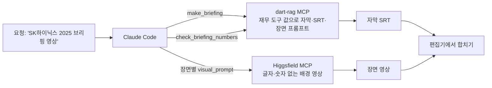

# 공시 → 숏폼 브리핑 영상 (dart-rag MCP + 영상 생성 MCP)

Claude Code 하나에 MCP 서버 두 개를 붙여, 사업보고서 숫자로 30초 이하 브리핑 영상을 만드는 흐름입니다.



## 왜 숫자를 영상 모델에 맡기지 않나

영상·이미지 생성 모델은 화면 속 글자와 숫자를 자주 틀리게 그립니다. 금융 브리핑에서 숫자가 틀리면 영상 전체를 못 씁니다.
그래서 역할을 나눴습니다.

| 부분 | 누가 만드나 | 검사 |
|---|---|---|
| 숫자 자막 | `make_briefing`이 재무 도구 값(`get_financials`·`financial_ratios`·`valuation`)으로 만듦 | `check_briefing_numbers`: 대본의 모든 숫자가 도구 값·연도·기준일에 있는지 |
| 배경 영상 | 영상 생성 MCP, 장면별 `visual_prompt`만 넘김 | 프롬프트에 숫자가 없는지 [eval/briefing_check.py](../eval/briefing_check.py)로 확인. 프롬프트에 "no text, no numbers, no logos" 포함 |
| 회사 로고·건물 | 쓰지 않음 | 업종별 일반 장면만 씀 (예: 반도체 → 클린룸) |
| 출처 | 마지막 장면 자막 "출처: DART 사업보고서 · 투자 권유 아님" | facts마다 DART 원문 링크 |

## 실행 방법

1. Higgsfield MCP를 Claude Code에 붙입니다 (처음 부를 때 로그인 창이 뜹니다).

   ```bash
   claude mcp add --transport http higgsfield https://mcp.higgsfield.ai/mcp
   ```

2. 이 레포 폴더에서 Claude Code를 열고(`.mcp.json`으로 dart-rag 서버가 붙음) 이렇게 요청합니다.

   > dart-rag의 make_briefing으로 SK하이닉스 2025년, 기준일 2026-11-09 브리핑을 만들어 줘.
   > 자막은 고치지 말고, scenes의 visual_prompt만 Higgsfield로 장면마다 짧은 영상으로 만들어 줘.
   > SRT는 out/SK하이닉스.srt로 저장해 줘.

3. 받은 장면 영상을 순서대로 이어 붙이고 SRT를 자막으로 얹습니다 (CapCut·DaVinci 등).

## 결과

### 대본 검사 (2026-11-10, [docs/briefing_check.json](briefing_check.json))

`python eval/briefing_check.py 2026-11-09` 결과입니다. API 키·영상 생성 없이 돌아갑니다.

| 항목 | 값 |
|---|---|
| 브리핑을 만든 회사 | 30곳 (2025 사업연도, 시가총액 기준일 2026-11-09) |
| 자막 속 숫자 | 209개, **30곳 모두 도구 값과 일치** |
| 자막 숫자 하나를 일부러 바꾼 대본 | 30건 중 **30건 검사에서 걸림** |
| 영상 프롬프트에 숫자가 들어간 경우 | 0건 (처음엔 통신 업종 프롬프트의 "5G" 때문에 2건 → 표현을 바꿈) |
| 영상 길이 | 12~22초 |
| 매출액 장면이 없는 회사 | 금융·보험 5곳 (매출액 계정이 없어 영업이익 또는 순이익으로 대신) |
| 시가총액 장면이 없는 회사 | 4곳 (신한지주, LG전자, 셀트리온, HD현대중공업: 수집된 주식수 자료에 보통주 유통주식수가 없음) |

예시 자막: [삼성전자](briefing_samples/삼성전자.srt), [KB금융](briefing_samples/KB금융.srt), [크래프톤](briefing_samples/크래프톤.srt)

### 영상 생성

아직 실행하지 않았습니다. 실행하면 회사별로 장면 수, 생성 시간, 사용 크레딧, 다시 만든 장면 수(화면에 글자·숫자가 나와 버린 경우)를 이 표에 적습니다.

| 회사 | 장면 | 생성 모델 | 생성 시간 | 크레딧 | 다시 만든 장면 |
|---|---|---|---|---|---|
| | | | | | |

## 한계

- 자막 문구는 정해진 틀이고, 회사 사업 설명 문장은 넣지 않았습니다 (`business_snippet`으로 원문 발췌만 줌). LLM이 설명 문장을 쓰면 `check_briefing_numbers`로 숫자만 검사할 수 있고, 문장 내용이 맞는지는 검사하지 않습니다.
- 숫자 검사는 "자막의 숫자 문자열이 도구 값 표기와 같은가"를 봅니다. "증가"를 "감소"로 바꾸는 것처럼 숫자가 아닌 말이 틀린 경우는 잡지 못합니다.
- 생성 영상의 이용 조건(상업적 이용·공개 범위)은 영상 생성 서비스 약관을 따릅니다.
